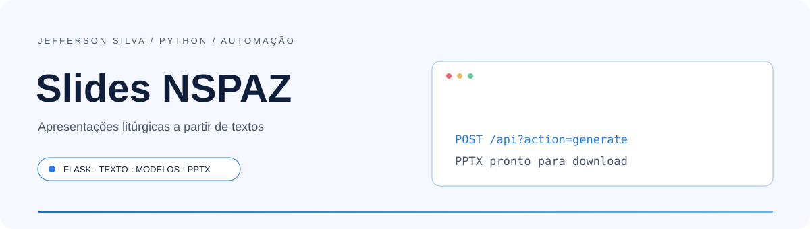
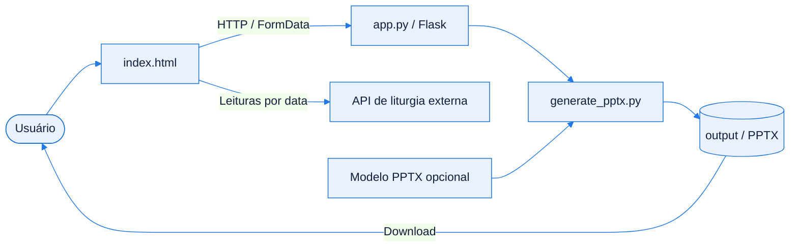
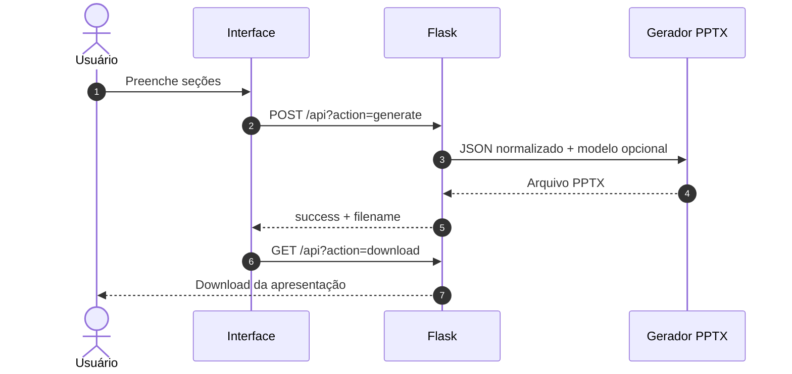
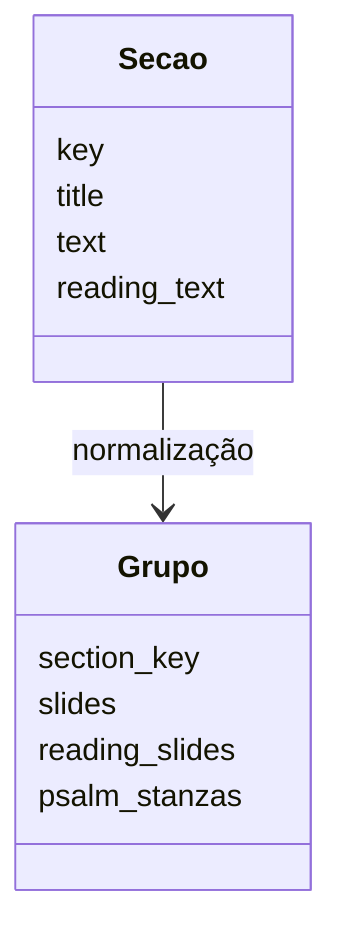

<!-- Jefferson Silva / README 4.0 — adaptado ao código de Slides NSPAZ. -->

<div align="center">

<picture>
  <source media="(prefers-color-scheme: dark)" srcset="./assets/banner-dark.svg" />
  <source media="(prefers-color-scheme: light)" srcset="./assets/banner-light.svg" />
  
</picture>

<br />
<br />

**Geração de apresentações litúrgicas com Python, Flask e PowerPoint.**

<p>
  <a href="#inicio-rapido"></a>
  <a href="https://github.com/jeffsilva03/slidesNSPAZ-public/issues/new"></a>
</p>

[](https://github.com/jeffsilva03/slidesNSPAZ-public/commits/)
[](https://github.com/jeffsilva03/slidesNSPAZ-public)
[](https://github.com/jeffsilva03/slidesNSPAZ-public)
[](https://github.com/jeffsilva03/slidesNSPAZ-public/issues)
[](https://github.com/jeffsilva03/slidesNSPAZ-public/stargazers)

<a href="#stack">
  <picture>
    <source media="(prefers-color-scheme: dark)" srcset="https://skillicons.dev/icons?i=python,flask,html,css,js&theme=dark" />
    
  </picture>
</a>

<br />
<br />

<a href="#visao-geral">Visão geral</a> &nbsp;•&nbsp;
<a href="#demonstracao">Demonstração</a> &nbsp;•&nbsp;
<a href="#funcionalidades">Funcionalidades</a> &nbsp;•&nbsp;
<a href="#stack">Stack</a> &nbsp;•&nbsp;
<a href="#arquitetura">Arquitetura</a> &nbsp;•&nbsp;
<a href="#inicio-rapido">Instalação</a> &nbsp;•&nbsp;
<a href="#exemplos">Exemplos</a> &nbsp;•&nbsp;
<a href="#roadmap">Roadmap</a> &nbsp;•&nbsp;
<a href="#contribuir">Contribuir</a>

</div>

<br />

> [!NOTE]
> **Status:** Geração implementada, com testes automatizados. Modelos são opcionais e fornecidos localmente; o serviço não possui autenticação.

> [!TIP]
> **Versão pública de portfólio:** esta cópia tem histórico próprio e usa exemplos fictícios. A aplicação em produção é gerenciada separadamente. Consulte [Sobre esta versão pública](./docs/versao-publica.md).

<a id="visao-geral"></a>
## ✦ Visão geral

**Slides NSPAZ** organiza textos de celebrações em apresentações `.pptx`. O frontend em HTML, CSS e JavaScript envia as seções ao backend Flask; o gerador Python distribui o conteúdo em slides e pode preservar a estrutura de um modelo enviado pelo usuário.

<table>
<tr>
<td width="33%" valign="top">

**🧩 Problema**

Preparar apresentações litúrgicas exige dividir textos, ordenar seções e ajustar leituras e salmos.

</td>
<td width="33%" valign="top">

**🛠️ Solução**

Centraliza a entrada de textos, consulta de leituras por data e geração de apresentações editáveis.

</td>
<td width="33%" valign="top">

**📈 Resultado**

Gera PPTX com ou sem modelo e inclui testes para ordem das leituras, salmos e compatibilidade de modelos.

</td>
</tr>
</table>

<a id="demonstracao"></a>
## ◐ Demonstração

<div align="center">

<picture>
  <source media="(prefers-color-scheme: dark)" srcset="./assets/screenshot-dark.svg" />
  
</picture>

<sub>Ilustração do fluxo; geração e download conferidos nos testes locais.</sub>

</div>

<details>
<summary><b>▶ Ver o fluxo em ação</b></summary>

Abra a aplicação, preencha uma seção e gere o arquivo. O exemplo HTTP em [Exemplos de uso](#exemplos) permite testar o mesmo fluxo sem a interface.

</details>

<a id="funcionalidades"></a>
## ◈ Funcionalidades

<sub>✅ Implementado &nbsp; 🚧 Parcial &nbsp; 🗓️ Planejado</sub>

| Módulo | O que faz | Estado |
| :-- | :-- | :-- |
| **Celebrações** | Seções para Dominical, Mãos Ensanguentadas e Cerco de Jericó | ✅ |
| **Textos** | Quebra de conteúdo, referências, leituras e salmo responsorial | ✅ |
| **Leituras por data** | Frontend consulta API externa e permite conferir o conteúdo | ✅ |
| **Modelos** | Upload de PPTX e geração preservando elementos do modelo; fallback sem modelo | ✅ |
| **Seções extras** | Capa JPG/PNG, título, texto e posição após outra seção | ✅ |
| **Extração de documentos** | Utilitários de extração existem, mas o formulário atual prioriza texto e leituras | 🚧 |

<details>
<summary><b>▶ Regras de negócio e validações</b></summary>

| Regra | Comportamento |
| :-- | :-- |
| Conteúdo | Ao menos uma seção preenchida para gerar |
| Seção extra | Exige título, texto e capa JPG, JPEG ou PNG |
| Modelo | Aceita extensão `.pptx` e verifica se o arquivo é ZIP; não valida todo o pacote OOXML |
| Upload | Limite padrão de 300 MB, configurável por ambiente |
| Arquivos gerados | Salvos em `output/`; nomes repetidos recebem sufixo |
| Modelos e saídas | Locais e compartilhados pela instância; não há isolamento por usuário |

</details>

<a id="stack"></a>
## ⚙ Stack e decisões técnicas

| Camada | Tecnologia | Por que foi escolhida |
| :-- | :-- | :-- |
| Backend | Python / Flask | Rotas de geração, upload e download |
| Apresentações | python-pptx / lxml / ZIP / OOXML | Criação de slides e manipulação da estrutura de modelos |
| Frontend | HTML / CSS / JavaScript | Interface sem etapa de build JavaScript |
| Extração | Biblioteca padrão Python / lxml | Leitura de documentos e conteúdo HTML nos utilitários |
| Hospedagem | Gunicorn / Render | Configuração de processo já presente no repositório |
| Alternativa | `api.php` | Backend alternativo preservado; a interface atual aponta para `/api` do Flask |

> [!TIP]
> `requirements.txt` declara versões mínimas, sem lockfile. Gunicorn deve ser usado em Linux/WSL; no Windows, execute Flask para desenvolvimento.

<a id="arquitetura"></a>
## ⬡ Arquitetura



<details>
<summary><b>▶ Responsabilidade de cada componente</b></summary>

| Componente | Responsabilidade |
| :-- | :-- |
| `index.html` | Formulário, leituras por data, upload e download |
| `app.py` | Normaliza o texto, agrupa seções e chama o gerador |
| `generate_pptx.py` | Gera apresentações com ou sem modelo |
| `extract_text.py` | Utilitários de extração de documentos e URLs |
| `assets/` | Imagens da interface e modelos locais ignorados pelo Git |

</details>

<details>
<summary><b>▶ Fluxo principal passo a passo</b></summary>



</details>

<details>
<summary><b>▶ Modelo de dados</b></summary>



Não há banco de dados; o estado persistente consiste em modelos enviados e apresentações geradas.

</details>

<a id="inicio-rapido"></a>
## ⚡ Início rápido

**Pré-requisitos**

| Ferramenta | Versão | Como verificar |
| :-- | :-- | :-- |
| Python | 3.14.3 usado na verificação | `python --version` |
| pip | Disponível no ambiente virtual | `python -m pip --version` |
| Git | Versão recente | `git --version` |

<details open>
<summary><b>Windows · PowerShell</b></summary>

```powershell
git clone https://github.com/jeffsilva03/slidesNSPAZ-public.git
cd slidesNSPAZ-public
python -m venv .venv
.\.venv\Scripts\python.exe -m pip install -r requirements.txt
.\.venv\Scripts\python.exe app.py
```

</details>

<details>
<summary><b>▶ Linux / macOS</b></summary>

```bash
git clone https://github.com/jeffsilva03/slidesNSPAZ-public.git
cd slidesNSPAZ-public
python3 -m venv .venv
.venv/bin/python -m pip install -r requirements.txt
.venv/bin/python app.py
```

Sequência documentada, não executada neste ambiente.

</details>

> [!TIP]
> Abra **http://localhost:5000**. Não há modelo PPTX incluído; você pode gerar sem modelo ou enviar um arquivo próprio pela interface.

**Variáveis de ambiente**

O app lê variáveis do processo; não carrega `.env` automaticamente.

| Variável | Obrigatória | Padrão | Descrição |
| :-- | :-- | :-- | :-- |
| `PORT` | — | `5000` no Flask / `10000` no Gunicorn | Porta HTTP |
| `MAX_TEMPLATE_UPLOAD_MB` | — | `300` | Limite global de upload em MB |
| `WEB_CONCURRENCY` | — | `1` | Workers do Gunicorn |
| `WEB_TIMEOUT` | — | `300` | Timeout do Gunicorn em segundos |
| `WEB_GRACEFUL_TIMEOUT` | — | `60` | Encerramento dos workers em segundos |

> [!IMPORTANT]
> A aplicação não exige login para gerar arquivos ou alterar modelos. Use em ambiente local ou coloque controle de acesso antes de disponibilizar uma instância.

<details>
<summary><b>▶ Problemas comuns</b></summary>

| Sintoma | Causa provável | Como resolver |
| :-- | :-- | :-- |
| Sem identidade visual no PPTX | Geração sem modelo | Envie seu PPTX pela interface |
| Erro 413 | Upload maior que o limite | Reduza o arquivo ou configure `MAX_TEMPLATE_UPLOAD_MB` |
| Leituras não carregam | API externa indisponível | Confira a data e preencha o texto manualmente |
| Gunicorn não inicia no Windows | Processo destinado a sistemas Unix | Use `python app.py` localmente ou Linux/WSL no deploy |

</details>

<a id="exemplos"></a>
## ◉ Exemplos de uso

<details open>
<summary><b>▶ Cenário principal</b></summary>

```powershell
$base = 'http://localhost:5000/api'
$dados = @{ mass_type = 'dominical'; text_cantico_entrada = 'Texto de exemplo para apresentação.'; custom_filename = 'exemplo' }
$resultado = Invoke-RestMethod -Method Post -Uri "$base`?action=generate" -Body $dados
Invoke-WebRequest -Uri "$base`?action=download&file=$($resultado.filename)" -OutFile exemplo.pptx
```

O primeiro comando gera a apresentação; o segundo baixa o PPTX. Use texto próprio ou conteúdo com autorização de uso.

</details>

<details>
<summary><b>▶ Endpoints da API</b></summary>

| Método | Rota | Descrição | Autenticação |
| :-- | :-- | :-- | :-- |
| `GET` | `/api?action=sections&mass_type=dominical` | Lista seções | — |
| `POST` | `/api?action=generate` | Gera arquivo a partir de FormData | — |
| `GET` | `/api?action=download&file=exemplo.pptx` | Baixa arquivo gerado | — |
| `POST` | `/api?action=upload_template&mass_type=dominical` | Upload no campo `template` | — |
| `GET` | `/api?action=has_template` | Informa disponibilidade de modelo | — |
| `GET` | `/api?action=delete_template` | Remove o modelo enviado | — |

Tipos: `dominical`, `maos` e `jerico`. Também há ações de diagnóstico `debug` e `debug_template`. Exclusão por GET e ausência de autenticação são limitações atuais.

</details>

<details>
<summary><b>▶ Testes e qualidade</b></summary>

| Comando | O que faz |
| :-- | :-- |
| `python -m unittest discover -s tests -v` | Executa a suíte de geração e isolamento de arquivos |
| `python -m compileall -q app.py extract_text.py generate_pptx.py` | Verifica sintaxe dos módulos |

Resultados e limites da verificação em [Validação da documentação](./docs/validacao-readme.md).

</details>

<a id="roadmap"></a>
## ◇ Roadmap

- [x] Gerar apresentações com e sem modelo
- [x] Preservar ordem de leituras e salmo responsorial
- [x] Documentar instalação e fluxo de geração
- [ ] Adicionar autenticação e isolamento dos arquivos por usuário
- [ ] Reforçar validação de uploads, retenção e limites de geração

<sub>Os itens pendentes são sugestões de evolução, sem prazo definido. Acompanhe e sugira melhorias nas <a href="https://github.com/jeffsilva03/slidesNSPAZ-public/issues">issues</a>.</sub>

<a id="documentacao"></a>
## ▤ Documentação

<details>
<summary><b>▶ Estrutura de pastas</b></summary>

```text
slidesNSPAZ-public/
├── app.py
├── generate_pptx.py
├── extract_text.py
├── api.php                     # alternativa preservada
├── index.html
├── assets/                     # banners e imagens da interface
├── docs/                       # auditoria e validação
├── tests/                      # geração e isolamento de arquivos
├── requirements.txt
├── render.yaml
├── gunicorn.conf.py
├── Procfile
└── README.md
```

</details>

<details>
<summary><b>▶ Perguntas frequentes</b></summary>

**O modelo da paróquia está incluído?**
Não. Os arquivos `.pptx` são ignorados; envie seu modelo autorizado pela interface.

**O PHP é necessário para rodar Flask?**
Não. `api.php` é uma alternativa existente, preservada e não validada nesta revisão.

**Existe licença de uso?**
Não há arquivo de licença; nenhuma licença foi presumida.

</details>

<details>
<summary><b>▶ Limitações e segurança</b></summary>

- **Limitações:** extração de PDF/DOC e serviços externos podem variar; o backend PHP não foi testado nesta revisão.
- **Segurança:** modelos e saídas são compartilhados pela instância, sem autenticação; há CORS amplo e rotas de diagnóstico. A pasta estática do Flask foi limitada a `assets/images/`.
- **Publicação:** esta cópia inicia um histórico novo e não inclui fotos removidas, GPS ou modelos privados; consulte a [auditoria](./docs/auditoria-portfolio.md).
- **Reportar vulnerabilidade:** combine um canal reservado com o autor; não envie segredos em issues públicas.

</details>

<a id="contribuir"></a>
## ⇄ Contribuir

1. Faça um fork e crie uma branch: `git checkout -b feat/minha-melhoria`
2. Faça commits seguindo o padrão abaixo
3. Rode `python -m unittest discover -s tests -v`, confira os fluxos alterados e execute os testes disponíveis antes de abrir o PR
4. Abra um Pull Request descrevendo o que mudou e por quê

<details>
<summary><b>▶ Padrão de commits</b></summary>

| Prefixo | Quando usar | Exemplo |
| :-- | :-- | :-- |
| `feat` | Nova funcionalidade | `feat: adiciona filtro por data` |
| `fix` | Correção de bug | `fix: corrige cálculo do total` |
| `docs` | Só documentação | `docs: atualiza instalação` |
| `refactor` | Mudança interna sem alterar comportamento | `refactor: separa serviço de e-mail` |
| `test` | Testes | `test: cobre fluxo de login` |
| `chore` | Configuração e manutenção | `chore: atualiza dependências` |

</details>

## ◎ Autor

<table>
<tr>
<td align="center" width="140">
  <a href="https://github.com/jeffsilva03"></a>
</td>
<td>

**Jefferson Silva**<br />
Autor de Slides NSPAZ<br />
Automação de apresentações com Python, Flask e OOXML.

<a href="https://github.com/jeffsilva03"></a>

</td>
</tr>
</table>

---

<div align="center">

Se este projeto foi útil, considere deixar uma ⭐ — isso ajuda outras pessoas a encontrá-lo.

<br />

<a href="#visao-geral"></a>

<sub>Python &nbsp;•&nbsp; Flask &nbsp;•&nbsp; PowerPoint</sub>

</div>
